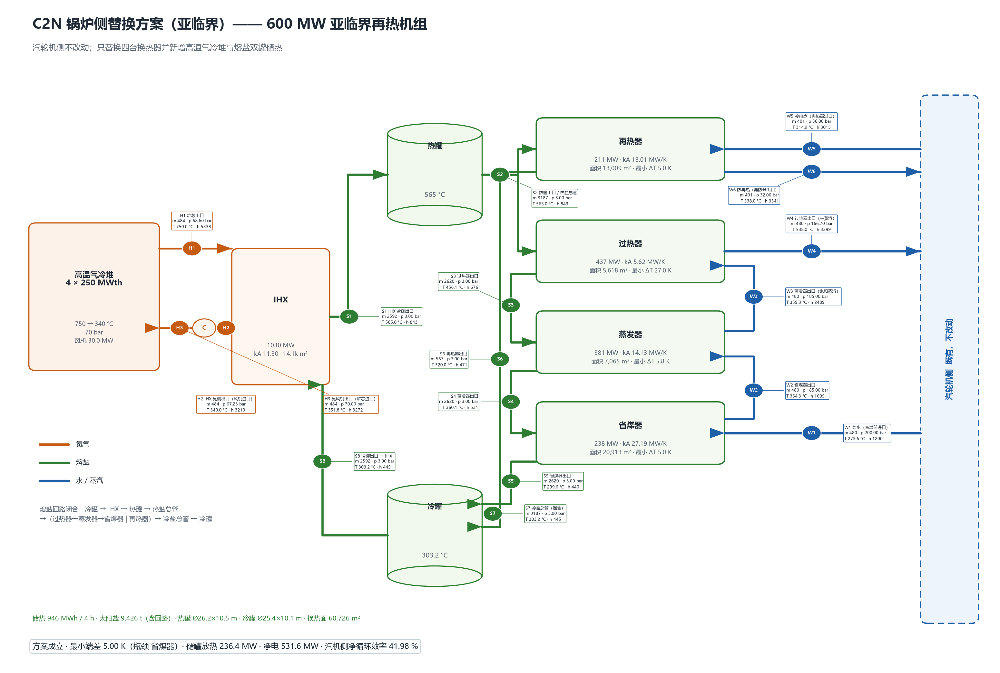

# C2N 锅炉侧替换方案（亚临界）：600 MW 亚临界再热机组

> 由 `python run.py` 自动生成。目标是**最小改动**：汽轮机本体、回热系统、
> 凝汽器、发电机全部不动，只替换锅炉侧的四台换热器、增加熔盐双罐储热与
> 高温气冷堆。

## 1. 业主提供的汽轮机侧边界（100 % 工况）

| 项目 | 数值 | 单位 |
|---|---:|---|
| 汽轮机毛电（口径：generator） | 589.8 | MW |
| 主蒸汽压力 / 温度 / 流量 | 166.7 / 538 / 479.91 | bar / °C / kg/s |
| 冷再热压力 / 温度 / 流量 | 36.0 / 314.9 / 401.04 | bar / °C / kg/s |
| 热再热压力 / 温度 | 32.0 / 538 | bar / °C |
| 汽包（蒸汽发生器）压力 | 185.0 | bar |
| 省煤器出口过冷度 | 5.0 | K |
| 给水压力 / 温度 | 200.0 / 273.6 | bar / °C |
| 盐种 | 太阳盐（60 % NaNO3 / 40 % KNO3）（分解温度 600 °C） | — |

## 2. 四台换热器（新的锅炉换热面）

这四个部件是锅炉与汽轮机的耦合面，也是本次改造**唯一需要更换的设备**。
kA 由**沿程积分** `∫dQ/ΔT` 求得（端点 LMTD 在蒸汽比热剧变时会偏 20~40 %）。

| 换热器 | 热负荷 MW | 所需 kA MW/K | 选型 kA MW/K | 面积 m² | 等效 LMTD K | 端差 热/冷 K | 沿程最小 K |
|---|---:|---:|---:|---:|---:|---:|---:|
| 过热器 | 436.7 | 5.62 | 5.62 | 5,618 | 77.74 | 27.0/96.9 | 27.00 |
| 蒸发器 | 381.0 | 14.13 | 14.13 | 7,065 | 26.96 | 96.9/5.8 | 5.79 |
| 省煤器 | 237.7 | 27.19 | 27.19 | 20,913 | 8.74 | 5.8/26.0 | 5.00 |
| 再热器 | 211.0 | 13.01 | 13.01 | 13,009 | 16.22 | 27.0/5.0 | 5.02 |

- 四台合计 **1266.4 MW**（主蒸汽段 1055.4 + 再热段 211.0）。
- 端差瓶颈 **省煤器（5.00 K）**，设计下限 5.0 K。
- 面积按 U = 过热器 1000 / 蒸发器 2000 / 省煤器 1300 / 再热器 1000 W/(m²·K) 折算，面积裕量系数 1.00（乘在"选型 kA"上，不改变所需 kA）。
- 主支路份额由反解得到：**0.822**（optimise_split = true）。
- **面积对夹点极敏感**：最小端差放宽 1 K（5 → 6 K），四台总面积 46,604 → 42,787 m²（-8 %）。

## 3. 设备尺寸：业主最常问的两个数

> 这一节把 `kA` 与 `MWh` 折算成**面积、外形、盐量、罐尺寸**。全部按常规壳管式换热器与立式圆筒罐估算，误差约 ±30 %，用于判断"厂房放不放得下、盐好不好运"，**不替代设备选型计算**。

### 3.1 要多少换热面积、换热器多大

| 设备 | 热负荷 MW | 面积 m² | 管数 | 管长 m | 管束 Ø m | 壳体内径 m | 壳体高 m | 并联台数 |
|---|---:|---:|---:|---:|---:|---:|---:|---:|
| 过热器 | 436.7 | 5,618 | 5,960 | 12 | 2.53 | 3.23 | 13.2 | 1 |
| 蒸发器 | 381.0 | 7,065 | 7,496 | 12 | 2.84 | 3.54 | 13.2 | 1 |
| 省煤器 | 237.7 | 20,913 | 22,188 | 12 | 2.82 | 3.52 | 13.2 | 3 |
| 再热器 | 211.0 | 13,009 | 13,802 | 12 | 2.73 | 3.43 | 13.2 | 2 |
| IHX（氦-盐） | 1030.0 | 14,122 | 14,984 | 12 | 2.84 | 3.54 | 13.2 | 2 |

- 四台换热器合计 **46,604 m²**，IHX **14,122 m²**，全部换热面 **60,726 m²**。
- 最大单台壳体 **Ø3.5 m × 13.2 m**，四台换热器共 **7 台并联壳体**，IHX 共 2 台。
- 面积取"选型 kA"（已含裕量 1.00），按 `面积 = kA / U` 折算；各设备的 U 见第 2 节。

**本节假设**（全部可在 `[sizing]` 里改）：

1. 壳管式、立式布置；换热管 Ø25×2 mm、长 12 m，正三角形排列、管间距 1.25d（= 31.2 mm）。
2. 管束直径按 `p·√(1.103 N)` 估算（六边形密排）；壳体内径 = 管束 + 2×0.35 m；壳体高 = 管长 + 1.2 m（管板、接管、封头）。
3. 单台壳体内径超过 4.0 m 时并联多台（运输限制），面积按壳体截面积均分。
4. 壳体壁厚、保温、管板厚度、折流板与压降均未建模；U 是经验值，实际面积由厂家按介质流速与污垢系数确定。
5. 氦-盐 IHX 工程上多用印刷电路板式（PCHE）或螺旋管式，本表按等效壳管式给出，实际体积会小很多。

### 3.2 要多少熔盐、储罐多大

| 项目 | 数值 | 单位 |
|---|---:|---|
| 储罐活动盐量（参与储热） | 8,569 | t |
| 回路滞留盐量（+10 %） | 857 | t |
| **需采购太阳盐总量** | **9,426** | **t** |
| 热罐有效容积 / 含气相空间 | 4,951 / 5,626 | m³ |
| 冷罐有效容积 / 含气相空间 | 4,517 / 5,133 | m³ |
| 热罐直径 × 高度 | Ø26.2 × 10.5 | m |
| 冷罐直径 × 高度 | Ø25.4 × 10.1 | m |
| 单罐占地 / 两罐合计 | 538 / 1,043 | m² |
| 储热容量 / 时长 | 946 / 4.0 | MWh / h |

**本节假设**（全部可在 `[sizing]` 里改）：

1. 双罐（冷/热分离）、完全混合；真实分层会略减所需容积（差 < 2 %）。
2. 每个罐都要能容纳全部活动盐量（放空/充满两种极端），气相空间 12 %（液位波动 + 氮封）。
3. 立式圆筒、平底拱顶，高径比 H/D = 0.4；罐壁钢材、保温、基础、伴热均未建模。
4. 盐密度按各罐温度（热罐 565 °C / 冷罐 303.2 °C）取自太阳盐拟合式。
5. 回路滞留按活动盐量的 10 % 计（管道、IHX、四台换热器与泵坑持液）。

## 4. 状态点（编号与拓扑图一致）

| 编号 | 节点 | 工质 | m kg/s | p bar | T °C | h kJ/kg | 说明 |
|---|---|---|---:|---:|---:|---:|---|
| H1 | 堆芯出口 | 氦气 | 484.0 | 68.60 | 750.0 | 5338 |  |
| H2 | IHX 氦侧出口（风机进口） | 氦气 | 484.0 | 67.23 | 340.0 | 3210 | 风机压比 1.0412 |
| H3 | 氦风机出口（堆芯进口） | 氦气 | 484.0 | 70.00 | 351.8 | 3272 | 风机轴功 30.0 MW |
| S1 | IHX 盐侧出口 | 太阳盐 | 2592.2 | 3.00 | 565.0 | 843 | 充热回路 |
| S2 | 热罐出口 / 热盐总管 | 太阳盐 | 3187.2 | 3.00 | 565.0 | 843 | 放热回路起点 |
| S3 | 过热器出口 | 太阳盐 | 2620.4 | 3.00 | 456.1 | 676 | 主支路 |
| S4 | 蒸发器出口 | 太阳盐 | 2620.4 | 3.00 | 360.1 | 531 | 主支路 |
| S5 | 省煤器出口 | 太阳盐 | 2620.4 | 3.00 | 299.6 | 440 | 主支路回盐 |
| S6 | 再热器出口 | 太阳盐 | 566.8 | 3.00 | 320.0 | 471 | 再热支路回盐 |
| S7 | 冷盐总管（混合） | 太阳盐 | 3187.2 | 3.00 | 303.2 | 445 | 主支路 2620 + 再热支路 567 kg/s |
| S8 | 冷罐出口 → IHX | 太阳盐 | 2592.2 | 3.00 | 303.2 | 445 | 充热回路起点 |
| W1 | 给水（省煤器进口） | 水 | 479.9 | 200.00 | 273.6 | 1200 |  |
| W2 | 省煤器出口 | 水 | 479.9 | 185.00 | 354.3 | 1695 | 过冷 5.0 K |
| W3 | 蒸发器出口（饱和蒸汽） | 蒸汽 | 479.9 | 185.00 | 359.3 | 2489 | x = 1 |
| W4 | 过热器出口（主蒸汽） | 蒸汽 | 479.9 | 166.70 | 538.0 | 3399 |  |
| W5 | 冷再热（再热器进口） | 蒸汽 | 401.0 | 36.00 | 314.9 | 3015 |  |
| W6 | 热再热（再热器出口） | 蒸汽 | 401.0 | 32.00 | 538.0 | 3541 |  |

> 熔盐回路闭合：冷罐 → IHX → 热罐 → 热盐总管 →（过热器→蒸发器→省煤器 | 再热器）→ 冷盐总管 → 冷罐。
> 编号与 `states.csv`、拓扑图上的圆标一一对应。

## 5. 高温气冷堆

| 项目 | 数值 | 单位 |
|---|---:|---|
| 模块数 × 单模块功率 | 4 × 250 | — / MWth |
| 堆芯总热功率 | 1000.0 | MWth |
| 氦气出口 / IHX 出口温度 | 750 / 340 | °C |
| 氦气压力（堆芯进口） | 70.0 | bar |
| 氦气总流量 | 483.98 | kg/s |
| 氦风机轴功 / 电耗 | 29.96 / 30.88 | MW |
| IHX 热负荷 | 1030.0 | MW |
| IHX 所需 kA / 面积 | 11.298 / 14,122 | MW/K / m² |

### 堆功率够不够？

100 % 工况下汽轮机需要 **1266.4 MW**，本配置的堆提供 **1030.0 MW**；
缺口 **236.4 MW 由储罐放热**，4.0 h 需要 946 MWh 储热容量。

> **注意：储热只能放、不能充。** 反应堆满功率时始终欠 236.4 MW，罐子在 4.0 h 后放空，此后若不加模块，机组只能维持 **81.3 %** 负荷（按热负荷比例估算）。若要求持续满发，需 **5 个模块（1250 MWth）**。

## 6. 熔盐回路与储热

| 项目 | 数值 | 单位 |
|---|---:|---|
| 热盐 / 冷盐温度 | 565.0 / 303.19 | °C |
| 盐流量（放热侧 / 充热侧） | 3187 / 2592 | kg/s |
| 主支路 / 再热支路流量 | 2620 / 567 | kg/s |
| 储热时长（100 % 工况） | 4.0 | h |
| 储热容量 | 946 | MWh |
| 太阳盐质量 | 8,569 | t |
| 热罐 / 冷罐容积 | 4,951 / 4,517 | m³ |
| 冷热罐总容积 | 9,468 | m³ |
| 盐泵电功率 | 0.82 | MW |

冷盐温度是**反解结果**：取使最紧端差等于 5.0 K 的盐流量，因此冷罐温度 303.19 °C 是这套换热面的必然结果，不是人为设定。

盐泵电功率按充热、放热两条回路**同时运行**计（反应堆常开，蒸汽发生器回路也常在运行状态）。

## 7. 出力与效率（同口径对比）

| 项目 | 煤电（改造前） | C2N（改造后） | 单位 |
|---|---:|---:|---|
| 毛电（发电机端） | 589.84 | 589.84 | MW |
| − 汽轮机岛辅机 | 26.50 | 26.50 | MW |
| − 煤粉炉辅机 | 12.00 | 0.00 | MW |
| − 氦风机 + 盐泵 | 0.00 | 31.70 | MW |
| 净电 | 551.34 | 531.64 | MW |
| 净电变化 | — | -19.70 | MW |

- **净电变化 = 煤粉炉辅机 − 氦风机 − 盐泵**，与汽轮机岛辅机无关。
- **汽机侧净循环效率 = 41.98 %** ＝ 净电 / 四台换热器吸热。
  分子 = 毛电 − 汽轮机岛辅机 − 氦风机电耗 − 盐泵电耗（全厂净电）；
  分母 = 四台换热器汽水侧吸热（主蒸汽段 + 再热段）。
  这是**蒸汽循环**的效率，**不是一次能源效率**：储罐吞吐与堆芯热功率都不进分母。
  充热工况下堆的多余热量进了储罐、当刻没有变成电，这一指标自然偏低；
  放热工况下储罐补的热量算在分母里，它也不会虚高。

## 8. 非额定工况估算（不建模汽轮机通流）

只引入三个可标定的工程关系，其余是精确热平衡：

- **滑压**：`p/p0 = (m/m0)^0.90`，流量比低于 0.70 时转定压节流；
- **级组效率**：`eta/eta0 = f(负荷)`，f 由 `[partload].eta_ratio` 给出（8 个点，默认取自亚临界再热机组滑压运行的常规范围）；
- **给水温度**：本次用输入卡给的给水温度表（与额定值一致）。表只提供随负荷变化的形状，绝对水平锚定在 `[plant].feedwater_t_c`。

| 负荷 % | 工况 | 主蒸汽 kg/s | 主蒸汽 bar | 给水 °C | 汽侧吸热 MW | 毛电 MW | 净电 MW | 储罐 ±MW | 满发可维持 h | 最低盐温 °C | 效率 % |
|---:|---|---:|---:|---:|---:|---:|---:|---:|---:|---:|---:|
| 100 | 放热 | 479.9 | 166.7 | 273.6 | 1266.4 | 589.8 | 531.6 | -236.4 | 4.0 | 299.6 | 41.98 |
| 90 | 放热 | 431.5 | 151.5 | 271.0 | 1148.9 | 530.9 | 474.3 | -119.0 | 7.9 | 298.4 | 41.28 |
| 80 | 平衡 | 383.7 | 136.3 | 267.5 | 1032.7 | 471.9 | 416.9 | -2.8 | —（平衡） | 297.2 | 40.37 |
| 70 | 充热 | 336.5 | 121.1 | 263.0 | 916.7 | 412.9 | 359.6 | +113.2 | 充满 8.4 | 296.0 | 39.22 |
| 60 | 充热 | 290.7 | 120.9 | 257.5 | 799.8 | 353.9 | 302.2 | +230.1 | 充满 4.1 | 295.5 | 37.79 |
| 50 | 充热 | 244.7 | 120.9 | 251.0 | 680.9 | 294.9 | 244.9 | +349.1 | 充满 2.7 | 294.9 | 35.97 |
| 40 | 充热 | 198.9 | 120.9 | 243.0 | 561.0 | 235.9 | 187.5 | +469.0 | 充满 2.0 | 294.3 | 33.43 |
| 30 | 充热 | 152.5 | 120.9 | 233.5 | 436.7 | 177.0 | 130.2 | +593.3 | 充满 1.6 | 293.5 | 29.81 |

> 汽机侧净循环效率随负荷单调变化：42.0 %（100 %）→ 29.8 %（30 %）。分母是四台换热器吸热，所以储罐充/放引起的「多余热量」不会让它出现台阶。

**盐侧温度**：冷罐温度由 IHX 钉死（反应堆恒定、充热盐流量恒定 ⇒ `Q_IHX = m_chg·Δh` 只有唯一解），本算例恒为 **303.2 °C**，不随汽轮机负荷变化；随负荷下降的是**四台换热器出口的盐温**，最低点出现在省煤器出口（上表「最低盐温」列）。

告警阈值：低于 **220 °C** 报「凝固风险」，低于 **290 °C** 报「距凝固温度裕量不足」（见 `[salt]`）。

> 两个盐温判据不是一回事，不矛盾：第 9 节的设计校核用 **238 + 20 = 258 °C**（红线，低于即判不可行）；这里的 220 / 290 °C 是**运行建议值**（低负荷时要不要干预）。前者判"能不能这样设计"，后者判"运行中什么时候该告警"。

本算例全负荷段最低盐温 293.5 °C，未触发告警。

> **满发可维持 h** 的定义：反应堆保持稳态（额定满功率）运行、汽轮机满发时，
> 储罐里存的熔盐能让机组维持满发多少小时（= 储热容量 / 放热功率）。
> 充热的行给的是相反的量——**充满时间**（多少小时后罐满，之后必须降堆或弃热）。

> 储罐列：**负 = 放热**（补汽轮机差额），**正 = 充热**（堆的余量存进罐）。
> 本表假设**反应堆恒定满功率**；若深调峰时同步降低堆功率，效率会高于表中值
> （那就超出本工具的定位，属于 `C2N_HTGR_Salt` 的变工况计算）。

估算误差约 ±1.5 个百分点，主要来自 `eta_ratio` 这条曲线；
请用机组热力特性书或性能试验数据替换 `[partload].eta_ratio`。

## 9. 校核

| 校核项 | 数值 | 判据 | 结论 |
|---|---:|---|---|
| 四台换热器最小端差（沿程） | 5.00 K @ 省煤器 | ≥ 5.0 K | 通过 |
| 冷盐与凝固点裕量 | 65.2 K | ≥ 20.0 K（即 ≥ 258 °C） | 通过 |
| 热盐分解温度 | 565 °C | ≤ 600 °C（太阳盐） | 通过 |
| IHX 冷端温差 | 36.8 K | ≥ 5.0 K | 通过 |
| 各换热段沿程温差 | 全部为正 | 无温度交叉 | 通过 |
| 100 % 工况热平衡 | 1029.96 = 1266.39 -236.43 | IHX = 汽侧吸热 + 储罐放热 | 通过 |
| 净电为正 | 531.64 MW | > 0 | 通过 |

## 10. 最小改动清单

| 类别 | 设备 | 说明 |
|---|---|---|
| 新增 | 高温气冷堆模块 ×4 | 含一回路氦风机 |
| 新增 | IHX ×4 | 合计 14,122 m²（单台 3,531 m²） |
| 新增 | 热盐罐 / 冷盐罐 | 共 9,468 m³ |
| 新增 | 盐泵 ×2 | 压损 2.0 bar，电耗 0.82 MW |
| **替换** | 过热器 / 蒸发器 / 省煤器 / 再热器 | 面积见第 2 节 |
| **取消** | 煤粉炉及其辅机（送/引风机、磨煤机等） | 自用电约 12.0 MW |
| 不改动 | 汽轮机本体、回热系统、凝汽器、发电机 | 边界条件由业主给定 |

## 11. 假设与局限

1. 汽轮机侧完全不动，只以四台换热器的汽水参数作为边界；因此**不校验**汽轮机通流能力与末级湿度（那需要机组本体数据）。
2. **同时支持亚临界汽包炉与超临界直流炉**：机型由 `[plant].turbine_class`（或主蒸汽压力）判定。亚临界按饱和温度分段；超临界没有饱和线，按水冷壁出口温度与拟临界温度分段——**该温度是业主给的边界，不是模型预测的**。
3. 四台换热器按逆流、沿程积分定 kA，再按给定 U 折算面积；U 是经验值，面积只用于量级判断，不能替代换热器选型计算。
4. 未建模减温喷水：若机组用过热器喷水，`Q_sh` 会偏大，请把喷水量并入给水流量或单独提供修正。
5. 储罐按**完全混合、绝热**定容（真实分层会略微减小所需容积，差 < 2 %），储热时长不含散热损失；储热只能放、不能充的问题见第 5 节。
6. 太阳盐（60 % NaNO3 / 40 % KNO3）的物性为工程拟合式，不用于冻结风险与详细传热计算。
7. 不含经济性：投资、年发电量、回本年限均未建模。
